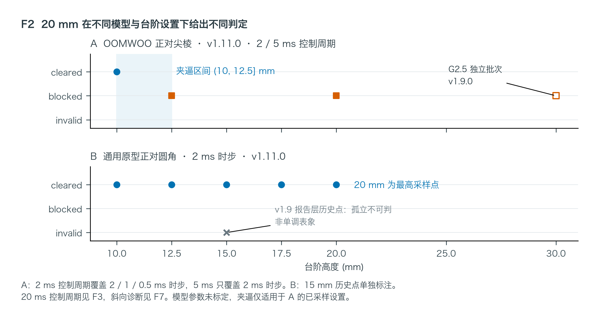
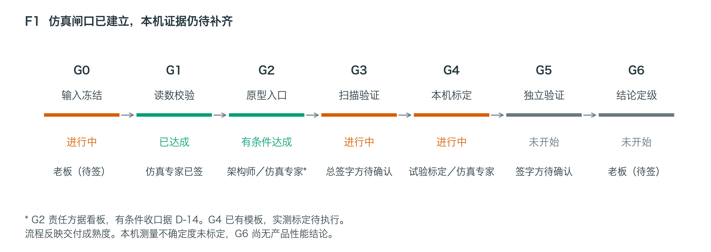
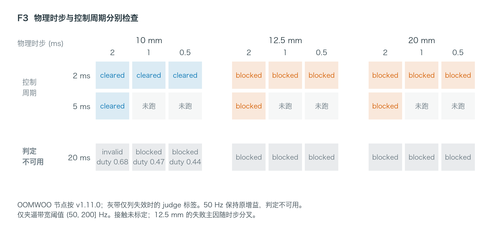
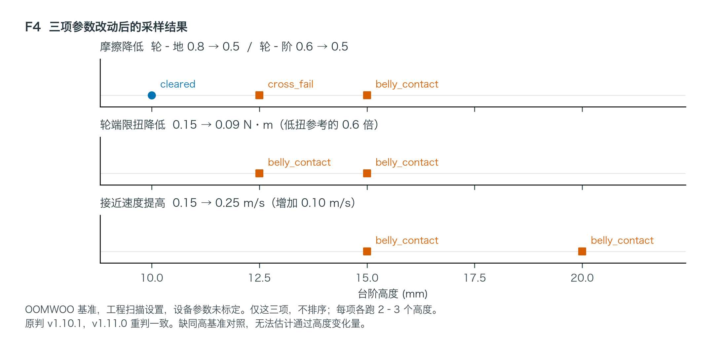
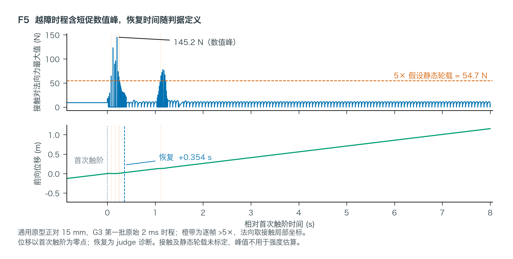
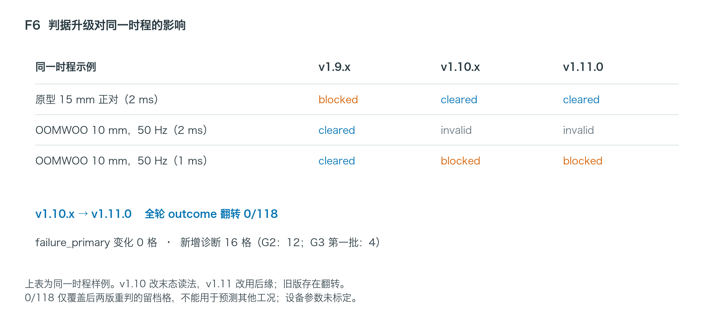
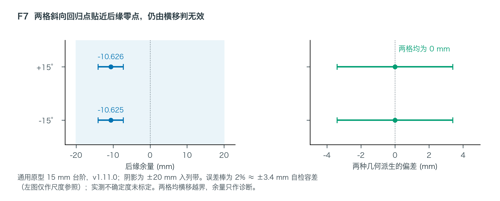
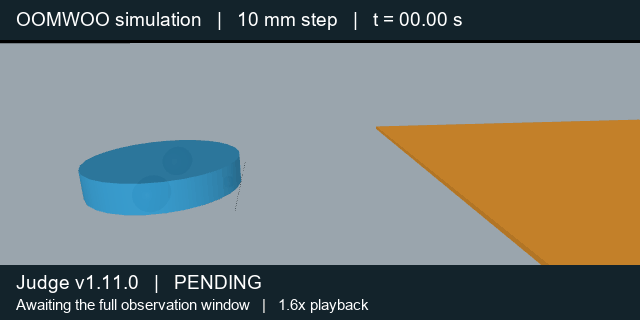
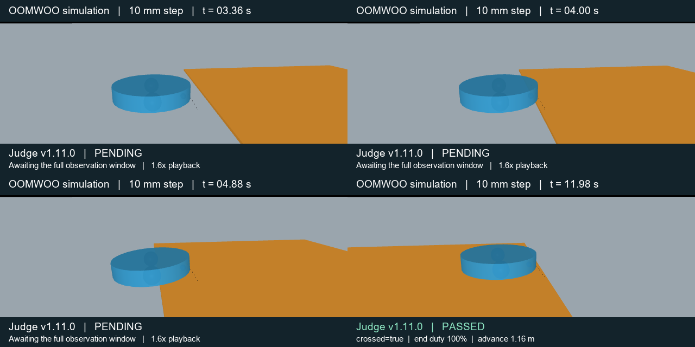

# 扫地机器人越障动力学 · 项目阶段汇报

2026-11-24 · 证据基线 `main@017eca0` · 面向项目决策、仿真和试验团队

## 1. 一页结论

**当前无法判定目标实机能否越过 20 mm 级台阶。** 在已有仿真中，通用原型正对圆角台阶时，10、12.5、15、17.5、20 mm 五个采样点均为 `cleared`，20 mm 是最高采样点。OOMWOO 基准正对尖棱台阶时，10 mm 为 `cleared`，12.5 mm 和 20 mm 为 `blocked`。该批边界夹在 **(10, 12.5] mm**，还未二分。两套模型、接触几何和驱动设定各异，现有数据无法分离这些因素对结果差异的贡献。两套结果经 v1.11.0 重判均保持原判。[G3 第一批 §8](../判据/G3-第一批-结果.md#8-v1110-重判后缘口径2026-11-23) · [时步报告 §8–§9](../G3-时步收敛报告.md#8-v1100-重判同数据不重跑)

**可信度为机理级（mechanism），控制带宽和参数扫为敏感性级（sensitivity）。** (10, 12.5] mm 只描述 OOMWOO 基准在本批尖棱、`solref=0.01 s`、既有增益和采样设置下的判定区间。5 ms 和 2 ms 两个控制周期未见区间变化，20 ms 在原增益下判定不可用。目标机型输入、接触标定及独立留出集均待补，现有证据不足以承诺实机通过高度、通过率、冲击载荷或标准符合性。[D-16、D-17](../项目状态/决策记录.md#d-16-g3-结论边界-10-125-mm控制带宽阈值-50-200-hz)

**F2｜正对单级台阶的离散判定。** A 为 OOMWOO 尖棱扫描，2 ms 控制覆盖三档物理时步，5 ms 控制仅有 2 ms 时步。30 mm 空心点来自独立 G2.5 批次（v1.9.0），只补充前下缘先碰立面的机理证据。B 为通用原型圆角扫描，旧版在 15 mm 有孤立的不可判标签，重判后该点为 `cleared`。两组均涉及工程假设，接触未标定。斜向不参与夹逼。[G2.5 前缘扩展](../试跑/G2.5-壳体前缘扩展.md) · [G3 第一批](../判据/G3-第一批-结果.md)

## 2. 问题与做法

一次运行只能说明给定模型、输入和判据产生了什么输出。前下缘先撞立面、驱动轮爬不上去、速度环控制不足以及斜向驶离台阶，都可能表现为失败或无效。项目沿三道证据线查明差异。

1. **几何与判据。** 原型为通用工程假设，OOMWOO 为非实测基准，两者分别追溯参数。记录首次接触部位，单独核对横向有效性、整机后缘、平台末态、行驶恢复和判退标志。接触读数以 `mj_contactForce` 为准，法向使用接触局部坐标。现有时程按新判据重判，保留历史结果以区分口径变化与模型变化。[接口契约](../契约/G2-接口契约.md) · [接触力读数校验](../接触力读数校验.md)
2. **时步与控制带宽。** 固定控制周期，在控制更新之间保持驱动指令，再改变物理积分时步。这样能观察 12.5 mm 同为受阻而主因随时步变化的现象。保留 50 Hz 批次的失效读数供检查，其结果排除在边界推断之外。[时步报告](../G3-时步收敛报告.md)
3. **参数敏感性。** 第二批对摩擦、限扭、接近速度分别改变一个维度，记录改动后的判定与主因。七批各两次一致。缺同高度配对对照，因此只描述采样点，暂不能估计各参数造成的通过高度变化量。[第二批 14 格证据](../验证输出/2026-11-23_G3-第二批-rejudge-v1.11.0/summary.csv)

## 3. 当前进度

状态综合了看板分工与 `main` 留档。已开始的准备工作计入 G4，G5 的准备材料与独立验证分别记录。

| Gate | 状态 | 到了哪一步 | 签字记录或责任方 |
| --- | --- | --- | --- |
| G0 输入冻结 | 进行中 | 输入台账、补测与接货清单已形成，目标机型 P0 待齐。[接货清单](../试验/机型包接货清单.md) | 老板负责，未见冻结签署 |
| G1 读数可信 | 已达成 | 平地、斜面及载荷变化下校核两种摩擦锥。[读数校验](../接触力读数校验.md) | 仿真专家已签，机理级通过、定量待标定。[签字记录](../判据/G1签字口径与G2打回记录.md) |
| G2 原型与入口 | 已达成（有条件） | 结构 M1–M5 闭环，工况入口、负例与重复性可复核。物理结论受 D-14 的三个条件限制。[运行记录](../G2-运行与验证记录.md) | 看板责任方为架构师与仿真专家，收口结论见 [D-14](../项目状态/决策记录.md#d-14-g2-收口条件与三条适用限制) |
| G3 扫描与收敛 | 进行中 | 时间步、控制周期、两批扫描及 v1.11.0 重判已留档。边界未二分，接触未标定。[时步报告](../G3-时步收敛报告.md) · [批次一](../判据/G3-第一批-结果.md) · [批次二](../判据/G3-第二批-结果.md) | 已见局部专家裁定，第一批重判仍标待签。Gate 总签字方待确认 |
| G4 本机标定 | 进行中（准备） | 模板、输入交接与验收限骨架已备，拟合集实测和拟合待执行。[冻结骨架](../试验/验收限冻结-2026-11-21.md) | 试验标定与仿真专家负责，未见冻结签署 |
| G5 独立验证 | 未开始 | 留出划分已有设计，独立实机比对待启动。[留出集说明](../试验/数据集划分-留出集.说明.md) | 看板签字方待确认 |
| G6 结论定级 | 未开始 | 已有阶段级机理与敏感性说明，实机定级依赖独立验证。[进度看板](../项目状态/进度看板.md) | 老板负责，未见 G6 签署 |

**F1｜G0–G6 证据链。** 箭头表示交付依赖，格内标实际状态和可追溯的签字方。G2 出口为有条件收口。机理级读数复核与本机测量不确定度属于不同工作，后者尚未标定。[看板](../项目状态/进度看板.md) · [决策记录](../项目状态/决策记录.md)

## 4. 关键结论与证据

| 结论 | 等级 | 适用范围与参数来源 | 证据 | 反例或例外 |
| --- | --- | --- | --- | --- |
| 20 mm 在通用原型圆角工况 `cleared`，在 OOMWOO 尖棱工况 `blocked:belly_contact` | mechanism | 正对、各自模型与设置的采样点，工程假设／非实测基准 | [第一批](../判据/G3-第一批-结果.md) · [时步批](../G3-时步收敛报告.md) | 原型组无更高受阻点可夹。G2.5 的 30 mm 为独立工况 |
| OOMWOO 尖棱组判定夹在 (10, 12.5] mm，离地间隙是本批机理解释 | mechanism | `solref=0.01 s`，2／5 ms 控制，v1.11.0 重判沿用 v1.10.0 判定 | [D-16](../项目状态/决策记录.md#d-16-g3-结论边界-10-125-mm控制带宽阈值-50-200-hz) · [时步重判](../验证输出/2026-11-23_G3-时步-rejudge-v1.11.0/README.md) | 12.5 mm 主因随时步分叉为 stall／belly_contact，5 ms 控制只测一个时步。G2.5 的独立 12.5 mm 工况为 cleared |
| 原增益条件下，判定可用性的带宽阈值只知 (50, 200] Hz | sensitivity | OOMWOO 工程模型，50／200／500 Hz 三个控制频率 | [时步报告 §8–§9](../G3-时步收敛报告.md#8-v1100-重判同数据不重跑) | 50 Hz 以原增益运行，10 mm 有灰带和越过失败；重调后结果未知 |
| 降摩擦后 10 mm 通过、12.5／15 mm 受阻；限扭及提速各自的两个高度均受阻 | sensitivity | OOMWOO 基准（非实测），2 ms 时步及周期，正对，v1.10.1／v1.11.0 | [D-17](../项目状态/决策记录.md#d-17-g3-第二批摩擦限扭速度结论与使用边界) · [第二批](../判据/G3-第二批-结果.md) | 缺同高基准。2.5 mm 是邻点间距，扭矩和速度分组只各测两个高度 |
| 斜向 ±15° 的 14、15、20 mm 因横移无效 | mechanism（仅诊断，斜向组不派等级） | 通用原型，左右入射分读，v1.10.1／v1.11.0 | [第一批 §2.4、§8](../判据/G3-第一批-结果.md#24-斜向-15v1100-原值--v1101-复核三列并存) | 10、12.5、13.5 mm 的低点有 cleared 记录，斜向组整体不用于通过边界。该批横移已超出可信范围 |
| v1.10.x → v1.11.0 在 118 个历史格中 outcome 与主失败原因均零翻转 | 判据回归 | 同一留档时程，重判覆盖 G2 及 G3 各批 | [G2 回归](../评审/G2-返工记录.md) · [贴临界集](../判据/贴临界回归集.md) | 16 格新增诊断，v1.9.x → v1.10.x 有实际翻转，未来近界点仍须回归 |

**F3｜先区分控制失效，再比较时步。** 三个小面板为 OOMWOO 10、12.5、20 mm 的 v1.11.0 判定。20 ms 区域单列失效标签及 10 mm 的末段占空比，原速度环增益未重调。5 ms 控制下只覆盖 2 ms 时步。接触未标定，本图只支持带宽阈值夹逼和已采样区间的一致性。[时步报告](../G3-时步收敛报告.md)

**F4｜只比较扫到的设置。** 摩擦同时降至 0.5，轮端限扭设为低扭参考值的 60%，速度增加 0.10 m/s。点的标签来自 judge；橙色方点为 blocked，蓝色圆点为 cleared。仅这三个参数改动，不排序。缺同高基准，且设备参数未标定，无法估计改动造成的通过高度变化。[第二批](../判据/G3-第二批-结果.md)

**F5｜冲击峰供数值诊断。** 取 G3 第一批原型正对 15 mm 的既有 2 ms 时程，每个接触对内加总局部法向力，再逐帧取最大接触对。横轴以首次触阶为零，位移也从该帧起算，judge 的 `t_recover` 为 0.354 s。超过 5×假设静态单轮载（静态估值 10.94 N）的帧区间着橙色。静态载荷未扣从动轮分载，接触未标定，145.2 N 峰值与恢复时间只用于仿真诊断。[第一批历史摘要](../验证输出/2026-11-22_G3-第一批/height_h15p0_summary.csv) · [接触采样口径](../G3-时步收敛报告.md#17-接触峰值口径)

## 5. 哪些数据还不够可信

- **标准方法待核。** P-1（R3 判退口径）和 P-2（R5 边界图方法）已由仿真专家有条件签署，等级均为 `mechanism`，依据仍是二手整理，待正版复核。P-3 将坡上速度排除出评分和判据。汇报采用项目自己的工况与数据。[口径裁定记录](../判据/口径裁定记录.md)
- **五项工程阈值暂定。** P-1 的越过容差、起始侧、卡住、跌落和翻倒五项均为【判】。首次本机试验后按重复性重标，连同采用的契约版本留痕。[P-1.1 与签署](../判据/口径裁定记录.md#p-11-判退条件的可执行性专家硬条件)
- **G2 数值适用域窄。** D-14 的收口限于物理时步 2 ms 与 `solref=0.01 s` 的联合单点、2 ms 控制周期（500 Hz）及准静态接近 `v ≤ 0.077 m/s`。2 ms 步长的接触刚度扫描受 `2 × timestep` 下限约束。G3 时步用例实际命令速度为 **0.15 m/s**，第二批提速档为 **0.25 m/s**。G3 的准静态表述为适用限制，实际触阶速度是否通过 A1–A4 在本汇报未核实，因此报告只引用这些批次的模型判定。接触峰值、恢复、滑移均为诊断量。[D-08、D-14、D-16](../项目状态/决策记录.md) · [10 mm 时步用例](../../cases/oomwoo_step10_dt2ms.json)
- **斜向有效性待修。** ±15° 的高点触发横向越界，同时横移超出模型可信范围。前置宽度校验通过，现有证据指向航向可信度。保留斜向样本并按角度分读，等航向和惯量积标定后再评价。[第一批斜向复核](../判据/G3-第一批-结果.md#241-斜向标签的-v1101-复核结果)
- **判据会改变同一时程的标签。** v1.9 扩充接触失败模式，v1.10 用末段占空比减轻单帧弹跳导致的误判，并区分横向无效，v1.10.1 复核横向标签优先级。v1.11 把越过观测位置切换到整机后缘，并加入坡道结构。D-15 的阶段结论已由 D-16 取代。零翻转只描述 v1.10.x → v1.11.0 的 118 格，F6 的 v1.9 历史示例展示了更早的实际翻转。[接口契约版本记录](../契约/G2-接口契约.md) · [D-15、D-16](../项目状态/决策记录.md#d-15-g3-结论时步敏感且未收敛)

**F6｜末态与后缘是两次不同的变更。** 同一原型 15 mm 时程曾从失败改为通过，50 Hz 样例从通过改为无效或失败。随后 v1.11.0 把前进越过条件改用后缘，118 格 outcome 与主失败原因均保持，16 格已有无效样本新增诊断。该结果描述留档数据，不能约束未验证的近界工况。[第一批 §3](../判据/G3-第一批-结果.md#3-结论变化v19x--v1100) · [时步报告 §9](../G3-时步收敛报告.md#9-v1110-重判后缘口径2026-11-23)

**F7｜两格都由横移判无效。** 15 mm 正负入射的后缘余量约 −10.6 mm，两种几何计算的派生偏差均为 0。误差棒显示 2%（约 ±3.4 mm）的派生自检容差，左图用同样长度作为尺度参照。±20 mm 阴影为回归入列范围，实测不确定度尚未评价。该余量用于回归诊断。[贴临界回归集](../判据/贴临界回归集.md)

## 6. 运动仿真展示

**F8｜OOMWOO 10 mm 正对尖棱。** Windows 从 `main@017eca0` 运行既有 `oomwoo_step10_dt2ms`，由 `mujoco.Renderer` 离屏渲染接近、首触、驱动轮触阶和判定窗口结束四帧。时程按 1.6×播放，judge 等完整观察窗口后才显示 `PASSED`。该窗口 judge 给出 `crossed=true`、末态占空比 100%、前进约 1.16 m。物理模型与配置均沿用基准，接触未标定，画面提供单个仿真样例。[既有 case](../../cases/oomwoo_step10_dt2ms.json) · [渲染脚本](media/render_step.py)

## 7. 下一步

1. **冻结 R3。** 在项目判退草案中钉住执行口径、适用性、契约 SHA 和签批记录，保留二手出处的待核状态以及五项工程阈值的首次实测复标条件。[R3 草案 PR](https://github.com/keylliucong/mujoco-robot-vacuum/pull/72) · [冻结前检查表](../试验/验收限-冻结前检查表.md)
2. **推进 G4 标定。** 补齐目标机型包、整机质量／质心／惯量、轮组悬挂、轮端扭矩与轮地／轮阶摩擦等关键输入，先冻结验收限，再用拟合集标定。静态配重口径单独核实，接触参数标定后复查时步与控制周期。[接货清单](../试验/机型包接货清单.md) · [机型包规范](../机型包规范.md)
3. **执行 G5 留出集。** 用未参与拟合的本机工况检验判定和误差；正对、斜向分组，保留无效和超限记录。验证通过后提交 G6 定级所需的边界图、容差与签批证据。[留出划分](../试验/数据集划分-留出集.说明.md) · [实施计划](../superpowers/plans/2026-11-21-obstacle-dynamics.md)

### 复现与数据入口

- F1–F7 用 [绘图脚本](figures/make_figures.py) 从 [验证输出](../验证输出/) 及既有 Windows 时程生成。F5 时程位于 `.tools\preserve\outputs-pre-v111-20261123\g3-b1\height_h15p0\g3_b1_height_h15p0\timeseries.csv`，属于 2026-11-22 批次。传入带中文覆盖的无衬线字体和该存档文件即可运行。
- 运动展示来自 Windows 11 `DESKTOP-RGG6DMC`，Python 3.13.0、MuJoCo 4.0.1。运行配置为 2 ms 时步及控制周期、`implicitfast`／`Newton`／`pyramidal`、100 次求解迭代。批次记录保存在 `E:\mujoco-robot-vacuum\outputs\report-2026-11-24-media\run.json`，渲染脚本只读取基准运行时的姿态和判定。
